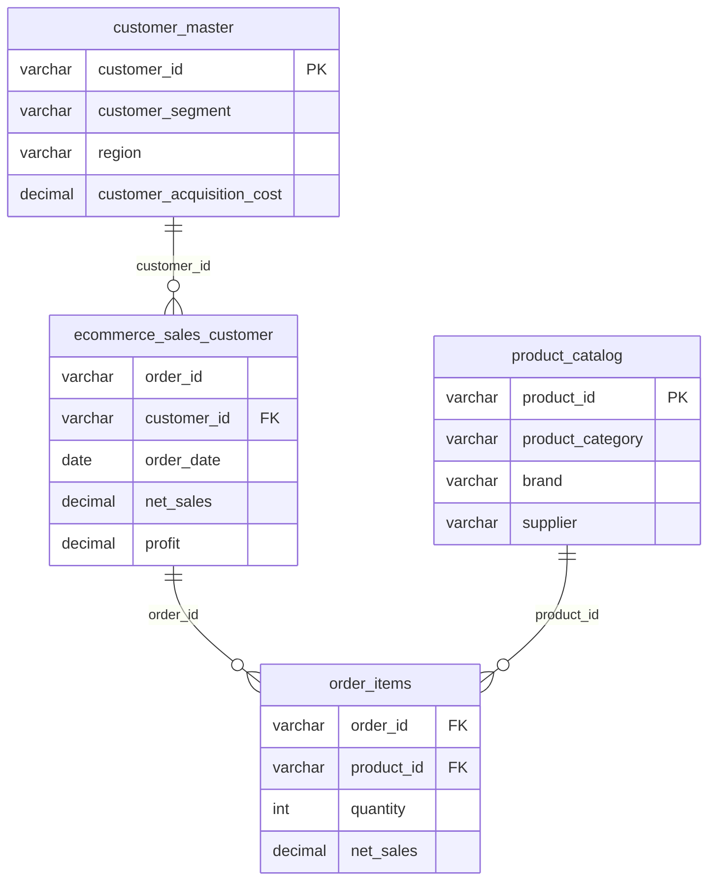

# E-Commerce Sales Analysis with SQL Server (SSMS)

An end-to-end SQL analysis of an e-commerce dataset made of five related files. The project covers database design, data loading, data quality validation, reconciliation against a summary file, reusable views, and about 30 analysis queries on sales, products, customers, operations and marketing.

## Project Goals

- Build a clean relational database from five CSV files.
- Validate data quality before analysing anything (keys, duplicates, orphan records, financial logic).
- Reconcile calculated totals against the provided summary file.
- Answer business questions about revenue, profit, customer behaviour, delivery performance, returns and marketing effectiveness.

## Tools

- **SQL Server** and **SQL Server Management Studio (SSMS)**
- **T-SQL**: CTEs, window functions (`LAG`, `NTILE`), views, indexes
- **Power BI** (planned): dashboard on top of the SQL views

## Dataset

Five CSV files, loaded into the `EcommerceDB` database:

| File / Table | Description | Grain |
|---|---|---|
| `customer_master` | Customer demographics, segment, location, acquisition cost | One row per customer |
| `product_catalog` | Product name, category, subcategory, brand, supplier, price, cost, rating | One row per product |
| `ecommerce_sales_customer` | Main transactions table (47 columns): order, payment, delivery, return, review, marketing and financial fields | Orders |
| `order_items` | Products, quantities and financials for each order | One row per order line |
| `dataset_statistic` | Dataset-level totals (transactions, revenue, profit, AOV, rating, return and cancellation rates) | Single summary row |

### Data Model



`dataset_statistic` is standalone and is used only to validate the results.

## Repository Structure

```
.
├── README.md
├──script
├── sql    # full project script (tables, load, checks, views, analysis)
└── data/                         # place the 5 CSV files here (not included)
```

## How to Run

1. Install SQL Server and SSMS.
2. Put the five CSV files in a folder, for example `C:\EcommerceProject\`.
3. Open `ecommerce_ssms_project.sql` in SSMS and update the file paths in **Part 2**.
4. Run the script **part by part** (highlight a section and press F5):

| Part | What it does |
|---|---|
| 1 | Creates the `EcommerceDB` database and the five tables |
| 2 | Loads the CSV files with `BULK INSERT` |
| 3 | Runs data quality checks |
| 4 | Reconciles calculated totals with `dataset_statistic` |
| 5 | Creates indexes and two analysis views |
| 6 | Runs the analysis queries |

If `BULK INSERT` fails, use **Tasks → Import Flat File** in SSMS and map each file to the matching table.

> After Part 3.4, check the real values in `order_status`, `return_status` and `is_repeat_customer`, and adjust the flag definitions in `vw_sales_orders` if they differ.

## Data Quality Checks

- Row counts per table and the grain of the sales table (one row per order or per line)
- Duplicate keys and exact duplicate order lines
- Orphan records: sales without a customer, items without an order or product, orders without items
- Missing values and value ranges (dates, ages, ratings, sales)
- Financial logic: `net_sales` vs. gross, discount, tax and shipping; `profit` vs. net sales minus cost
- Consistency of customer attributes between `customer_master` and the sales table
- Totals in `order_items` vs. the sales table (to avoid double counting)

## Views

- **`vw_sales_orders`**: one row per order, with month and year, cancelled, returned and late-delivery flags, delay in days, and customer acquisition cost.
- **`vw_order_items_detail`**: one row per order line, enriched with product and order context.

Use `vw_sales_orders` for order-level metrics and `vw_order_items_detail` for product-level metrics. Joining the two and summing money columns would double count.

## Analysis Covered

**Sales performance**
- Headline KPIs (orders, customers, revenue, profit, margin, average order value)
- Monthly revenue with month-over-month growth, yearly summary, seasonality
- Revenue by sales channel, region, city and payment method

**Products**
- Top products, category and subcategory performance
- Brand and supplier performance
- High-revenue, low-margin products
- Margin by discount band

**Customers**
- Segment, age group and gender performance
- Top customers, repeat vs. one-time customers
- RFM segmentation
- Acquisition cost vs. profit per customer
- First-order cohort retention
- Customer lifetime value and loyalty points

**Operations**
- Delivery performance by shipping method and warehouse
- Effect of late delivery on ratings and returns
- Return rate by category and return reasons
- Cancellation rate by channel and payment method

**Marketing**
- Marketing channel and campaign performance
- Coupon impact on order value and margin

**Customer experience**
- Rating distribution and review sentiment
- Lowest-rated product categories

## Key Findings

_Add your findings here after running the analysis, for example:_

- Revenue trend and strongest months
- Best and worst categories by margin
- Customer segments with the best profit-to-acquisition-cost ratio
- Warehouses or shipping methods with the highest late-delivery rates
- Campaigns that generate revenue but erode margin

## Next Steps

- Build a Power BI dashboard on `vw_sales_orders` and `vw_order_items_detail`
- Add stored procedures for monthly KPI reporting
- Forecast monthly sales with Python

## Author

**Omer Ibrahim**
- GitHub: [EngOmerYilmiz](https://github.com/EngOmerYilmiz)
- LinkedIn: [omer-ibrahim-ahmed](https://linkedin.com/in/omer-ibrahim-ahmed)
